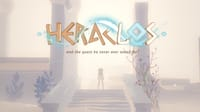
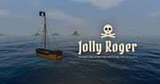
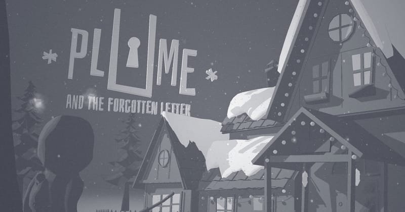
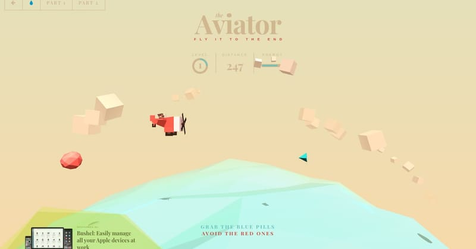
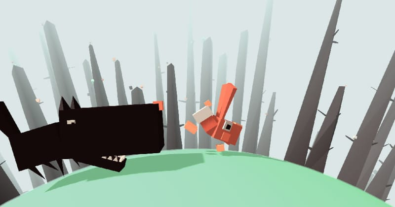

# Adventure Games

## Heraclos

**Category:** Adventure

A short, polished 3D adventure about a reluctant hero in ancient Greece, made as a graduation project at the Gobelins school. The story is split into chapters.

**How to Play:** Pick a quality level to match your computer, then start a new game. Follow the on-screen prompts through each chapter; you can return to any chapter from the menu.

[▶ Play Game](https://heraclosgame.com/)

---

## Jolly Roger

**Category:** Adventure

An open-world 3D pirate adventure. Sail an open sea, trade between harbors, fight rival ships broadside to broadside, board and capture them, and go ashore anywhere to dig up buried treasure. Hunt down four captains for the pieces of a legendary map. Free in your browser on phone or desktop, with no account and nothing to buy.

**How to Play:** A and D steer, W and S set or furl the sails, and drag to look around; she is fastest with the wind behind her. Fire a broadside with Space when a gun button glows, or pick a side with Q and E. Come alongside a crippled ship and press F to board, then click to cut and hold Shift to guard. Press F to dock at a harbor, anchor off a beach to swim ashore, and press F on a red X to dig. On touch, steer with the left stick.

[▶ Play Game](https://jollyroger.greenrobot.com/)

---

## Plume

**Category:** Adventure

A beautiful third-person adventure game with a unique art style and stunning visual effects. Explore a mysterious world and solve puzzles in this atmospheric experience.

**How to Play:** Use WASD to move, mouse to look around, and click to interact with objects. On mobile, use the virtual joystick and tap to interact. Collect items and solve puzzles to progress through the story.

[▶ Play Game](https://plumegame.com/)

---

## The Aviator

**Category:** Adventure

A stylish 3D game where you fly a plane through a colorful world, collecting items. Originally created as a Three.js tutorial, this game features beautiful low-poly visuals, smooth animations, and simple yet engaging gameplay in a vibrant environment.

**How to Play:** Use your mouse or touch input to control the plane's movement. Move the cursor left and right to steer the plane horizontally, up and down to control altitude. Collect the floating coins while avoiding obstacles. The game demonstrates core concepts of 3D web development with an appealing aesthetic.

[▶ Play Game](https://tympanus.net/Tutorials/TheAviator/)

---

## The Frantic Run Of The Valorous Rabbit

**Category:** Adventure

An endless runner where you control a rabbit on a spherical world. Built with Three.js, this charming game features a unique perspective as you guide your rabbit around a planet, avoiding obstacles and collecting items. The distinctive art style and creative gameplay mechanics showcase the capabilities of 3D web technologies.

**How to Play:** Use left and right arrow keys or A/D to move the rabbit around the planet. Jump with Space or the up arrow key to avoid obstacles. The game increases in difficulty as you progress, requiring quick reflexes and good timing. See how far you can run before hitting an obstacle!

[▶ Play Game](https://codepen.io/Yakudoo/full/YGxYej)

---

