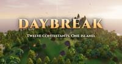
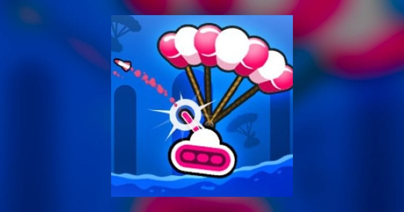

# Battle Royale Games

## Daybreak

**Category:** Battle Royale

A free 3D battle royale on a shrinking island. Twelve contestants smash crates for weapons, chain hits into heavy finishers and dodge-roll out of danger. A supply drop lands at every daybreak and the tide rises every night. Last one standing wins. Play online or solo against bots, in your browser on phone or desktop.

**How to Play:** WASD to move, mouse or drag to look, click or J to attack, Space to jump, Shift or right-click to dodge-roll, Q to switch weapons, Tab for the scoreboard. Walk over loot to take it and over food to heal. Land three hits in a row for a heavy finisher, and keep to high ground at night because the sea drains your health. Touch: left thumb moves, drag on the right to look, the big button attacks.

[▶ Play Game](https://daybreak.greenrobot.com/)

---

## Rocket Bot Royale

**Category:** Battle Royale

A side-scrolling tank battle game with a focus on physics and destruction. Control a tank equipped with rockets and other weapons, battling against other players in a last-tank-standing format. Features destructible terrain, power-ups, and strategic gameplay in a 2D environment with 3D graphics.

**How to Play:** Use A/D or Left/Right arrows to move your tank. Adjust your firing angle with W/S or Up/Down. Press Space to fire your weapon. Collect power-ups and coins to upgrade your tank and weapons. The rising water level forces players to move upward as the match progresses. Be the last tank surviving to win!

[▶ Play Game](https://rocketbotroyale.com)

---

