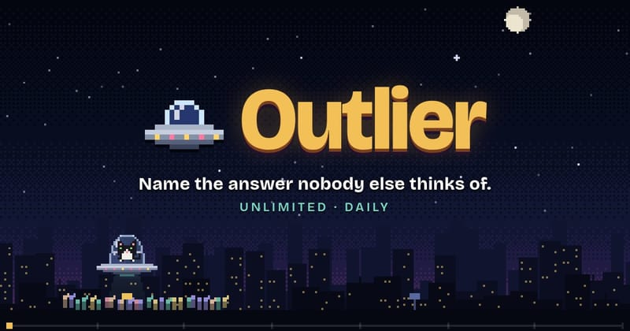

# Puzzle Games

## Kacho Refine

**Category:** Puzzle

A 3D remake of a 1998 panel puzzle game. Guide a penguin to the goal by turning the arrow tiles it walks over, while germ enemies follow the same arrows. It has 30 stages and a stage builder for making your own.

**How to Play:** Turn the arrow panels with the mouse or touch to steer the penguin. Collect the four panels on each stage, then reach the goal. Switch the language to English on the loading screen. The first load takes about 30 seconds.

[▶ Play Game](https://kacho.modern-orange.com/)

---

## Outlier: Unlimited Krillion Game

**Category:** Puzzle

A free unlimited Krillion-style rare-answer trivia game with no daily cap. Name something that fits the category; the rarer your correct answer, the further your cat pilot's UFO flies over a pixel-art city.

**How to Play:** You get a category (e.g. name a river, a cheese, an NBA team) and one answer. Type your answer: obvious picks score a little, rare correct picks score a lot. Your S/A/B grade decides how far the UFO flies. Play in any browser, desktop or mobile, no download.

[▶ Play Game](https://playkrillion.net/)

---

## The Cube

**Category:** Puzzle

An interactive 3D Rubik's Cube puzzle built with Three.js. Solve the classic puzzle in your browser with smooth animations and intuitive controls. Features customizable cube sizes from 2x2 to 5x5, multiple difficulty levels, and the ability to scramble and reset the cube.

**How to Play:** Click and drag on the cube faces to rotate them. Use the control panel to adjust settings like cube size and scramble difficulty. Solve the puzzle by aligning all colors on each face. For keyboard controls, use the arrow keys to rotate the cube view and WASD to rotate faces. A perfect demonstration of 3D manipulation in the browser.

[▶ Play Game](https://codepen.io/bsehovac/pen/EMyWVv)

---

## xx142-b2.exe

**Category:** Puzzle

A JS13kGames winner where you infiltrate an alien network as a virus. Navigate through a stylized representation of computer systems, avoiding detection while completing objectives. Features unique hacking mechanics, minimalist visuals, and an atmospheric soundtrack, all compressed into less than 13KB of JavaScript.

**How to Play:** Use WASD or arrow keys to move through the network. Press Space or E to interact with nodes and systems. Avoid detection by security measures and complete your objectives to progress. The game presents a series of increasingly difficult puzzles that require stealth and strategy to overcome.

[▶ Play Game](https://play.js13kgames.com/xx142-b2exe/)

---

