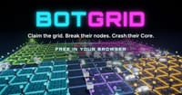

# RTS Games

## BotGrid

**Category:** RTS

A real-time territory strategy game on a neon circuit board. Build robots that claim nodes, fight rivals and hack enemy Cores while you power your network out from your own Core. Take on up to five AI rivals from Easy to Brutal, or play online with friends. Free in your browser on phone or desktop.

**How to Play:** Own 3 of a cell's 4 corner nodes to claim it and earn energy, then spend energy on bots: Build bots claim nodes, Strike bots fight and Hack bots break enemy nodes and Cores. Nodes cut off from your Core go dark. Win by crashing every rival Core or by holding most of the grid for 40 seconds. Keyboard: drag or WASD to pan, wheel to zoom, 1-9 to build, U to upgrade, Space to jump home. Touch: drag to look, pinch to zoom, tap a bot to build it.

[▶ Play Game](https://botgrid.greenrobot.com/)

---

## Warzone 2100

**Category:** RTS

The open-source 3D real-time strategy game from 1999, officially ported to the browser. Build a base, research technology, design your own tanks from parts and fight through the campaign or a skirmish against the AI.

**How to Play:** Choose Play Now under Web Edition. The first run downloads about 60 MB of game data. Start the campaign or a skirmish, build structures and factories, research upgrades and send your units to destroy the enemy base. Played with mouse and keyboard.

[▶ Play Game](https://play.wz2100.net/)

---

