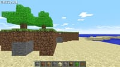
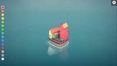

# Sandbox Games

## Minecraft Classic

**Category:** Sandbox

Mojang's official browser release of the original 2009 creative build of Minecraft. Wander a small block world and build with the 32 original blocks. No mobs, no survival, and no account needed.

**How to Play:** WASD to move, Space to jump and the mouse to look. Use the mouse buttons to break and place blocks. Press B to choose a block, or use the number keys for the hotbar.

[▶ Play Game](https://classic.minecraft.net/)

---

## Townscaper

**Category:** Sandbox

The web demo of the town-building toy. Click on the open sea and colourful houses, arches, stairways and towers assemble themselves into an island town. There are no goals and no way to lose.

**How to Play:** Left-click to add a block and right-click to remove one. Pick a colour from the palette on the left. Stack blocks and build over water to see how the houses connect. The first load takes around 20 seconds.

[▶ Play Game](https://oskarstalberg.com/Townscaper/)

---

