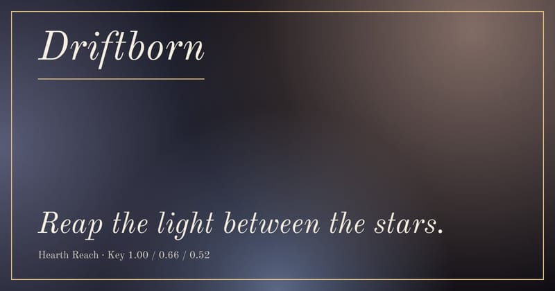
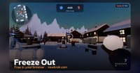
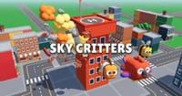

# Shooter Games

## Driftborn

**Category:** Shooter

A single-player space shooter across twenty-six connected sectors, with two enemy factions, named boss ships that each have attack patterns to learn, and ship builds made from hulls, equipment and technologies. An arcade cabinet mode adds eight vertical-scrolling stages and a daily run with a global board.

**How to Play:** Plays best with mouse and keyboard in a desktop browser; touch works on recent phones and tablets. No account is needed to play. The game shows its controls on screen.

[▶ Play Game](https://driftborn.space/)

---

## Freeze Out

**Category:** Shooter

A first-person snowball fight: four against four with bots across eight winter maps, from an alpine village to an ice rink. It has three game modes and tournament cups, and no ads.

**How to Play:** Works with keyboard and mouse, touch or a gamepad. Click or tap to throw a snowball, and hold to wind up a longer throw. Choose Quick match to jump in, or Training to practise first.

[▶ Play Game](https://newkrok.com/gamer-zone/freeze-out)

---

## Sky Critters

**Category:** Shooter

Fly a drone over a toy-like 3D city and shoot down waves of flying critters before they reach your base tower. Earn coins to upgrade your gear, alone or in multiplayer.

**How to Play:** WASD to fly, mouse to look, Space and Shift to go up and down, and click to shoot. Keys 1-4 switch weapons. M mutes sounds and N mutes music.

[▶ Play Game](https://skycritters.io/)

---

