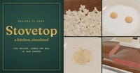

# Simulator Games

## Fly.Pieter.com

**Category:** Simulator

A fun free-to-play MMO flight sim, made with AI. Fly and dogfight with your friends online.

**How to Play:** Fly your plane with the controls on your keyboard or using the virtual joystick on mobile

[▶ Play Game](https://fly.pieter.com)

---

## Slow Roads

**Category:** Simulator

An endless driving game with no traffic, no timer and no goal. The road, hills and scenery are generated as you go, so you can cruise for as long as you like. Runs straight in the browser with nothing to install.

**How to Play:** Click begin, then steer with WASD. Press F to switch on autodrive and just watch the scenery. The hints shown at the start list the other keys.

[▶ Play Game](https://slowroads.io/)

---

## Stovetop

**Category:** Simulator

A cooking simulation set in a detailed 3D kitchen. Make popcorn, eggs, pancakes, spaghetti aglio e olio and a pan-seared steak on a gas hob where the heat, oil, water and flame are all simulated.

**How to Play:** Tap to open, then use the mouse to pick up ingredients and tools and to work the hob. The cookbook in the kitchen has the recipes; nothing else tells you the steps. Best with sound on.

[▶ Play Game](https://frustum.me/play/stovetop/)

---

