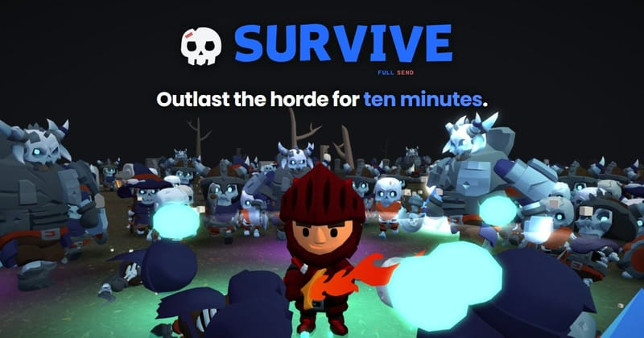

# Survival Games

## Full Send Survive

**Category:** Survival

A horde survival game where you pick one of nine classes and try to last ten minutes against hundreds of enemies, choosing an upgrade every time you level up, before the zone's boss arrives. Ten zones, harder Heroic and Nightmare tiers, and a weekly challenge leaderboard.

**How to Play:** Best on a computer. The first three zones and one hero need no account; signing in with Discord unlocks the rest and co-op for up to four players. The game shows its controls on screen.

[▶ Play Game](https://fullsendsurvive.com/)

---

## Hollowlands

**Category:** Survival

A third-person survival and crafting game in a stylised, procedurally generated world. Explore, gather resources, craft tools, build and fight, on your own or online with other players.

**How to Play:** Choose Singleplayer or Online Multiplayer. WASD to move, Shift to run, Space to jump and R to open your inventory. The first quests on screen get you started.

[▶ Play Game](https://hollowlands.andreelias.dev/)

---

